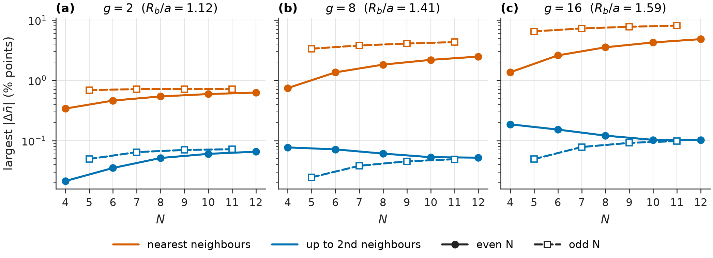

# Rydberg atom research

Classical simulations of laser-driven Rydberg atom chains: exact diagonalization (ED), DMRG and effective models for uniform and dimerized chains with van der Waals interactions.

## Research question

**How does dimerizing the atomic spacing change the ordered phases of a laser-driven Rydberg chain?**

The model has one Rydberg level, a uniform drive Ω and detuning Δ, and all C₆/r⁶ interactions. Atoms alternate between a short gap a(1−ε) and a long gap a(1+ε). An excitation shared by a strong pair carries a pseudo-spin, left or right atom, and the geometry fixes how these pseudo-spins couple. The working hypotheses are:

- the ℤ₂ crystal melts through a single Ising line that an effective pseudo-spin model predicts at strong dimerization;
- dimerization splits the melting of the period-4 (ℤ₄) crystal into two transitions with a pair-density-wave phase between them;
- the period-3 (ℤ₃) crystal has no such splitting.

These hypotheses rest on pilot calculations; the production computations and their go/no-go gates are in the [research plan](docs/RESEARCH_PLAN.md), and the analytic picture is in the [theory notes](docs/DIMERIZED_THEORY.md).

## What is here

| Path | Content | Status |
|---|---|---|
| [`study/`](study/) | Completed finite-chain study (N ≤ 12): two-atom blockade, interaction switch-off controls, four-atom geometries, interaction-range cutoffs, odd/even chains, an exploratory kagome patch; scripts, CSV/JSON results, figures and two teaching notebooks ([foundations](study/Foundations.ipynb), [finite chains](study/Finite_Chain_Study.ipynb)) | Frozen record, checksum-verified |
| [`rydberg_chain/`](rydberg_chain/) | Maintained package: geometry, sparse ED, observables, effective model, finite DMRG (atom or pair sites), infinite DMRG, figure style | Tested |
| [`tests/`](tests/) | pytest suite: study equivalence, analytic limits, DMRG against ED, effective model | Run before every change |
| [`validation/`](validation/) | Benchmarks and their JSON results: solver cost versus N, exactly solvable and literature benchmarks, iDMRG gate | See [notes](validation/BENCHMARK_NOTES.md) |
| [`paper/`](paper/) | Manuscript section drafts and [`make_figures.py`](paper/make_figures.py), which writes [`paper/figures/`](paper/figures/FIGURES.md) from saved data | Draft |
| [`research/pilots/`](research/pilots/2026-09-27/README.md) | Exploratory scripts and raw outputs behind the preliminary numbers | Not package code |
| [`docs/`](docs/) | [Notation](docs/NOTATION.md), [methods](docs/METHODS.md), [results and limits](docs/RESULTS_AND_LIMITS.md), [validation](docs/VALIDATION.md), [provenance](docs/PROVENANCE.md) | |



Keeping only nearest-neighbour interactions shifts the ground-state density of a uniform open chain by up to 8.1 percentage points at N ≤ 12 (N = 11); odd chains exceed their even neighbours, and at g = 8 and 16 the error still grows with N within each parity up to N = 12. With second neighbours the shift stays below 0.19 points. The dimerized-chain calculations therefore keep the long-range tail. Details: [`paper/figures/FIGURES.md`](paper/figures/FIGURES.md).

## Install and test

Python 3.11 or later. From the repository root:

```sh
python -m venv .venv
.venv/bin/python -m pip install -r requirements.txt
export OMP_NUM_THREADS=2 OPENBLAS_NUM_THREADS=2 MKL_NUM_THREADS=2
.venv/bin/python -m pytest                     # full suite
.venv/bin/python -m pytest tests/test_geometry_ed.py tests/test_effective.py tests/test_dmrg.py   # core, about 1 min
.venv/bin/python study/verify_delivery.py      # checksums of the frozen study
```

`requirements.txt` pins the package environment (NumPy, SciPy, Matplotlib, TeNPy, pytest). The historical study has its own pinned `study/requirements.txt`, which adds Qiskit and the notebook tools; with that environment, `python study/run_project.py --section chains` reruns a historical scan into a new folder under `study/runs/` without touching the delivered files, and the notebooks open with `study/` as the working directory.

## Use the package

```python
from rydberg_chain import ed, observables, dmrg

# Uniform chain, N = 12, g = (R_b/a)^6 = 8, Delta/Omega = 3, all pairs
H = ed.chain_hamiltonian(12, eps=0.0, g=8.0, delta=3.0)
energies, vectors, residuals = ed.lowest_states(H, k=2)
energies[0]                                            # -18.39930535753886
observables.staggered_order_squared(vectors[:, 0], 12) # <Q^2> = 0.17287

# Dimerized chain, 20 atoms as 10 four-state pair sites (about a minute)
E0, psi, obs = dmrg.pair_chain_ground_state(eps=0.3, g=11.39, delta=2.5, n_pairs=10, chi=64)
```

Regenerate the publication figures and their manifest (reads saved data only):

```sh
.venv/bin/python paper/make_figures.py
```

## Limitations

- The simulations are classical calculations of an ideal model: no decoherence, preparation or detection errors, and no atom-position disorder.
- The completed study covers N ≤ 12 with open ends. It maps finite systems; it does not locate bulk phase boundaries.
- Even open chains in the ℤ₂ regime hold one boundary-forced domain wall. Finite DMRG on such chains converges slowly beyond about 50 atoms, so large-N results need odd chains, pinned ends or infinite DMRG.
- The dimerized-chain phase structure is preliminary. Several pilots used restricted bases that must be checked against the full Hilbert space before any claim is made.

The code, pilots and documentation were developed with AI assistance; see [provenance](docs/PROVENANCE.md).
