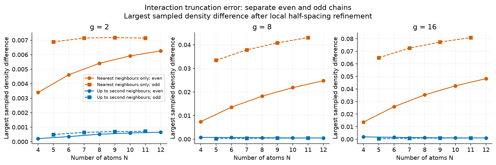

# Rydberg atom research

Classical simulations of small Rydberg arrays: blockade, entanglement, interaction-range approximations and odd/even effects in finite open chains.

This is the public scientific package. It contains the corrected model, calculation scripts, saved numerical data, figures and teaching notebooks. The results describe finite idealised systems; they do not establish a bulk phase transition, a quantum spin liquid, a hardware result or a novel phase.

## Read and explore

- [Foundations notebook](study/Foundations.ipynb): the two-atom matrix, dynamics, blockade, Qiskit comparisons, entropy and geometry.
- [Finite-chain notebook](study/Finite_Chain_Study.ipynb): interaction cutoffs, odd/even chains, low-energy configurations and an optional kagome example.
- [Methods and code map](docs/METHODS.md): equations, basis ordering, numerical methods and file roles.
- [Results and limitations](docs/RESULTS_AND_LIMITS.md): what the saved evidence supports and which earlier interpretations were corrected.
- [Future work](docs/FUTURE_WORK.md): a proposed alternating-interaction experiment. It has not yet been run.
- [Validation](docs/VALIDATION.md) and [provenance](docs/PROVENANCE.md).



The figure shows sampled approximation errors for finite open chains. Different size maxima may occur at different detunings; this is not a universal size law. See the fixed-setting comparisons and spatial profiles in the results guide.

## Run

Use Python 3.12 and an isolated environment. From the repository root on macOS or Linux:

```sh
python3.12 -m venv .venv
.venv/bin/python -m pip install -r study/requirements.txt
.venv/bin/python study/verify_delivery.py
.venv/bin/python tools/check_current_model.py
.venv/bin/python study/run_project.py --section chains
```

Select this environment in a notebook editor and open either notebook with its working directory set to `study/`. The requirements include kernel and execution libraries; install a notebook editor separately if needed. Windows uses the environment's `Scripts/python.exe`. The pinned requirements preserve a tested Mac environment and may need platform-specific adjustment elsewhere.

The chain command checks its bundled numerical reference and computes the corrected scan. Other sections are `foundations`, `optional` and `all`. Each managed run writes beneath `study/runs/` in a new completed or failed directory; it does not replace delivered data or rewrite the prose. Those new runs are ignored by Git until deliberately selected. The package launcher uses a `.venv` inside `study/`; the commands above use the root environment instead.

## Contents

`study/` contains model code, notebooks, `results/`, `figures/` and the immutable `reference_data/` used for regression. `docs/` explains the methods, conclusions and limits. `tools/` contains a short numerical check. All numerical result and reference data files retained from the corrected study are unchanged; public-facing narrative and notebook metadata were cleaned separately.

These materials were developed with AI assistance. Computational verification is distinct from independent authorship, experimental validation and scientific novelty. This repository is a research record, not a peer-reviewed publication. No institutional endorsement or authorship agreement is implied. Public papers are cited by links; no third-party datasets or full upstream repositories are bundled. No new software licence is assigned by this cleanup.
